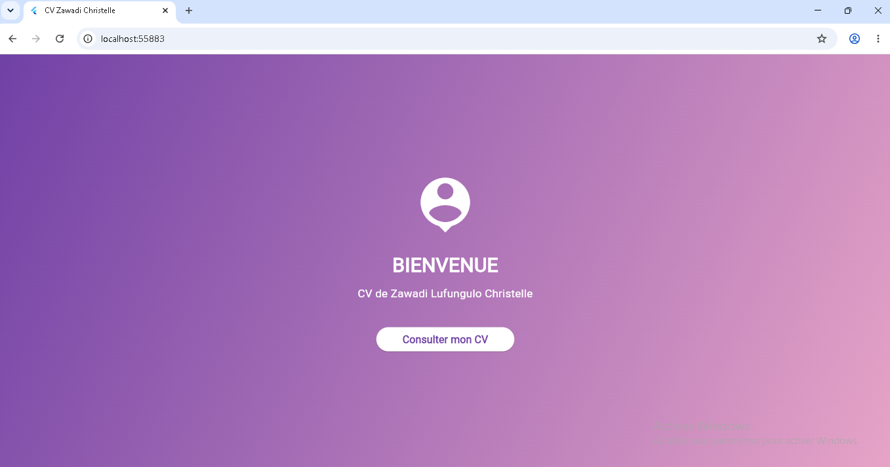
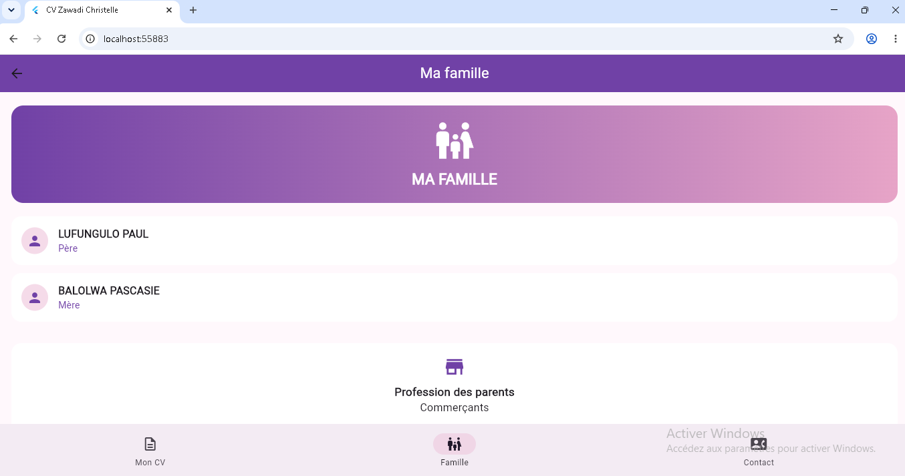

<<<<<<< HEAD
# zawadi_lufungulo
=======
# christelle_cv_flutter
>>>>>>> 71821f7 (Mise à jour finale TP Flutter Zawadi Christelle)

A new Flutter project.

## Getting Started
<<<<<<< HEAD
## Vidéo de démonstration

Regarder la démonstration complète du TP2 : [Voir la vidéo sur Google Drive](https://drive.google.com/file/d/1lJ1JqyVaFaaVf1Cb-oT0wClkzMCxXUF4/view?usp=sharing)

## Captures d'écran

### 1. Page de connexion

### 2. Page d'accueil (CV)

### 3. Page famille

### 4. Page contact

=======

>>>>>>> 71821f7 (Mise à jour finale TP Flutter Zawadi Christelle)
This project is a starting point for a Flutter application.

A few resources to get you started if this is your first Flutter project:

<<<<<<< HEAD
- [Learn Flutter](https://docs.flutter.dev/get-started/learn-flutter)
- [Write your first Flutter app](https://docs.flutter.dev/get-started/codelab)
- [Flutter learning resources](https://docs.flutter.dev/reference/learning-resources)
=======
- [Lab: Write your first Flutter app](https://docs.flutter.dev/get-started/codelab)
- [Cookbook: Useful Flutter samples](https://docs.flutter.dev/cookbook)
>>>>>>> 71821f7 (Mise à jour finale TP Flutter Zawadi Christelle)

For help getting started with Flutter development, view the
[online documentation](https://docs.flutter.dev/), which offers tutorials,
samples, guidance on mobile development, and a full API reference.
